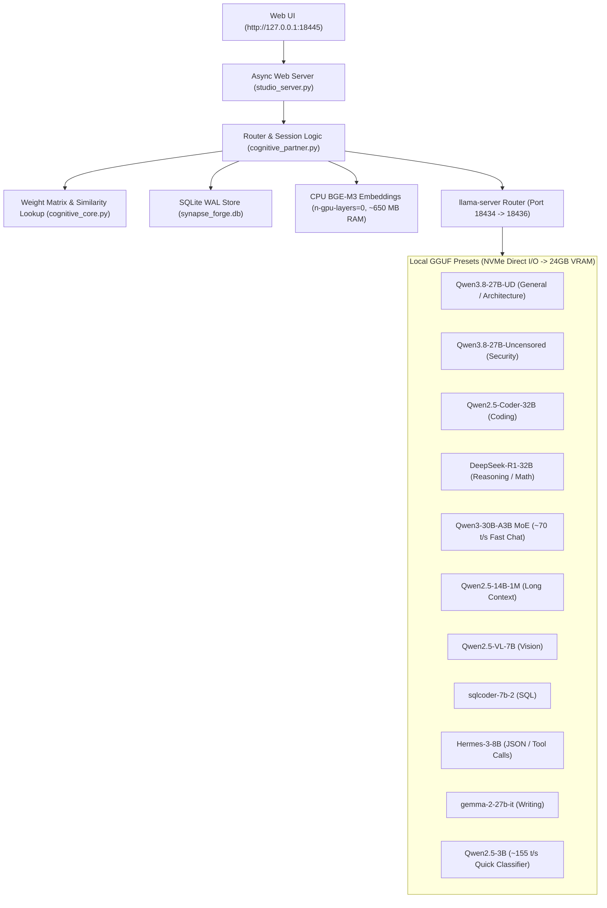

# Synapse Mind (`synapse-mind`)

A personal local-AI router, persistent memory store, and web UI built for a single 24GB GPU (**NVIDIA RTX 3090**) paired with a Gen4 NVMe drive on Ubuntu.

Instead of manually loading and unloading GGUF files every time I switch from coding to SQL or reading a long log, `synapse-mind` sits in front of `llama-server` (router mode) on `http://127.0.0.1:18445` and handles three practical jobs:

1. Keeps `bge-m3` (`1024-dim` embeddings) loaded in CPU RAM (`n-gpu-layers = 0`) alongside whichever 7B-32B model is active in VRAM, so storing and searching past chat notes never forces `llama-server` to unload the main GPU model.
2. Routes incoming prompts across 13 local GGUF presets, and when a prompt looks unfamiliar compared to past episodes in SQLite, queries two models (for example `DeepSeek-R1-Distill-Qwen-32B` + `Qwen2.5-Coder-32B-Instruct`) before combining the answer.
3. Logs episodes, feedback scores, and pairwise model routing weights in a local SQLite WAL database (`synapse_forge.db`).

## How it fits together



## Under the hood

### 1. Co-resident CPU `bge-m3` + 24GB GPU model (`--models-max 2`)
Running `llama-server` with `--models-max 2 --load-mode dio` and pinning `[bge-m3]` to CPU (`n-gpu-layers = 0` in [`presets/fleet_presets.example.ini`](presets/fleet_presets.example.ini)) solves the most annoying bottleneck on a single 24GB card:
- `bge-m3` stays resident in normal system RAM (`~650 MB`) and computes `1024-dim` embeddings in under `25 ms`.
- All 24 GB of GDDR6X VRAM stays free for a 27B/30B/32B model without swapping models in and out just to embed a search query.
- `--load-mode dio` (NVMe Direct I/O) bypasses Linux page-cache thrashing and keeps cold 18.5 GB 32B model switches down around `8.8 seconds` on a Samsung 990 PRO.

### 2. Bounded routing weights (Oja's rule)
After each turn or multi-model run, `CognitiveCore.compute_oja_update` in [`cognitive_core.py`](cognitive_core.py) updates a $13 \times 13$ weight matrix $W$ tracking which model pairs work well together:

$$\Delta w_{ij} = \eta \, r \, \left( y_i x_j - y_i^2 w_{ij} \right)$$

where $x_j$ and $y_i$ are the model activations, $\eta$ is the step size, and $r \in [-1, 1]$ is the TD feedback score. Using Oja's $-y_i^2 w_{ij}$ decay term keeps the matrix norm bounded ($\|W\|_F < \infty$) so weights don't blow up over hundreds of turns.

### 3. Embedding novelty check ($S(x)$) & Hopfield-style lookup
Incoming prompts are compared against stored episode embeddings in SQLite using cosine distance:

$$S(x) = 1 - \max_{m \in \mathcal{M}} \frac{\mathbf{e}(x) \cdot \mathbf{e}(m)}{\|\mathbf{e}(x)\| \, \|\mathbf{e}(m)\|}$$

Routine prompts go straight to one preset; when $S(x) > 0.72$, `CognitivePartner` escalates to a two-model pass (such as pairing `DeepSeek-R1-Distill-Qwen-32B` with `Qwen2.5-Coder-32B-Instruct`) and merges their outputs, alongside log-sum-exp Hopfield-style associative retrieval over past notes.

## Local GGUF presets used on my RTX 3090

| Index | Model ID | What I use it for | Typical speed (RTX 3090) |
| :--- | :--- | :--- | :--- |
| `0` | `Qwen3.8-27B-UD-Q4_K_M` | General design & planning | ~42 t/s |
| `1` | `Qwen3.8-27B-Uncensored` | Security & red-team testing | ~42 t/s |
| `2` | `Qwen2.5-Coder-32B-Instruct` | Main 32B coding model | ~36 t/s |
| `3` | `DeepSeek-R1-Distill-Qwen-32B` | Step-by-step logic, debugging & math | ~35 t/s |
| `4` | `Qwen2.5-Coder-14B-Instruct` | Quicker 14B code edits | ~68 t/s |
| `5` | `DeepSeek-R1-Distill-Qwen-14B` | Faster reasoning checks | ~66 t/s |
| `6` | `Qwen2.5-VL-7B-Instruct` | Screenshots, OCR & UI inspection | ~95 t/s |
| `7` | `sqlcoder-7b-2` | SQL queries & schema drafts | ~105 t/s |
| `8` | `Qwen2.5-Coder-14B-abliterated` | Binary / exploit auditing | ~68 t/s |
| `9` | `Hermes-3-Llama-3.1-8B` | Structured JSON & tool calling | ~98 t/s |
| `10` | `gemma-2-27b-it` | Long-form writing & docs | ~40 t/s |
| `11` | `bge-m3` | CPU-pinned 1024-dim embeddings | <25ms / embed |
| `12` | `Qwen3-30B-A3B` | Fast 30B MoE (3B active) everyday chat | ~70.6 t/s |
| `+` | `Qwen2.5-14B-Instruct-1M` | Long-context log & repo reader (up to 128K) | ~64 t/s |
| `+` | `Qwen2.5-3B-Instruct-abliterated` | Fast prompt classifier | ~155.1 t/s |

## Quickstart

### 1. Install Python dependencies
```bash
pip install -r requirements.txt
```

### 2. Start `llama-server` in router mode
Edit [`presets/fleet_presets.example.ini`](presets/fleet_presets.example.ini) to point at your own `.gguf` folder, then run:

```bash
llama-server \
  --models-preset presets/fleet_presets.example.ini \
  --models-max 2 \
  --load-mode dio \
  --port 18434
```

### 3. Start the web server
```bash
python studio_server.py
```

Open `http://127.0.0.1:18445/` in your browser.

### Optional environment variables
| Variable | Default | Description |
| :--- | :--- | :--- |
| `SYNAPSE_PROXY_URL` | `http://127.0.0.1:18434/v1` | OpenAI-compatible local router URL |
| `SYNAPSE_API_KEY` | `local-key` | Bearer token if your local router checks one |
| `SYNAPSE_DB_PATH` | `./synapse_forge.db` | Path to the SQLite WAL database |
| `JARVIS_MEMORY_DB` | `../jarvis/memory.db` | Optional path to a shared external `memory.db` |

## Running the tests
```bash
pytest tests/ -q
```
Runs the test suite covering the Oja/Hopfield/TD($\lambda$) math helpers, SQLite WAL concurrency, AST sandbox checks, and HTTP/WebSocket routes.

## Notes & Licence

This is an experimental local-AI project built for my own RTX 3090 setup, put together with plenty of help from AI coding assistants on the routing math, async `aiohttp` server boilerplate, web UI, and test suite.

Released under the [MIT License](LICENSE).
