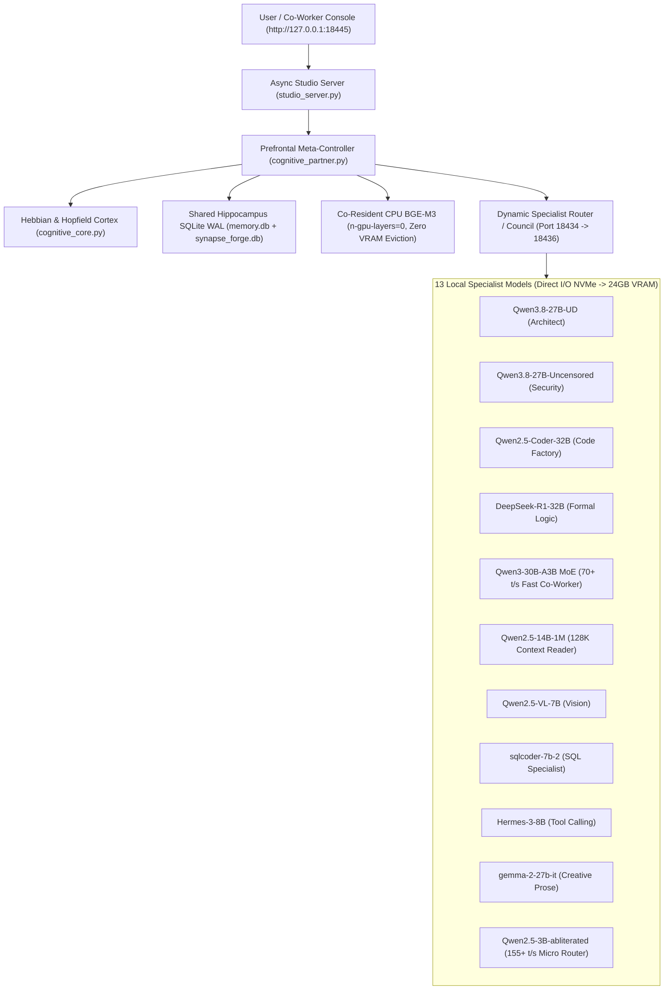

# Synapse Mind — Unified 13-Model Sentient Co-Worker & Continual Learning Cortex

**Synapse Mind** (`synapse_forge`) is a bio-inspired, continual-learning cognitive partner and multi-model orchestration studio designed for a single consumer 24GB GPU (e.g., **NVIDIA GeForce RTX 3090 / 4090**) paired with a PCIe Gen4 NVMe drive (e.g., **Samsung 990 PRO**).

Instead of treating local LLMs as isolated, stateless chatbots, Synapse Mind sits as a **Prefrontal Meta-Controller** above **13 specialized local GGUF models** (`llama-server` router mode), giving them:

1. **Zero-Eviction Semantic Memory & Bayesian Surprise ($S(x)$)** via CPU-pinned `BGE-M3` (`1024-dim` embeddings co-resident alongside any 27B–32B GPU LLM).
2. **Oja's Normalized Hebbian Synaptic Plasticity** across a $13 \times 13$ specialist connectivity graph ($\Delta W_{ij} = \eta (y_i x_j - y_i^2 W_{ij})$).
3. **Modern Continuous Hopfield Associative Recall** & **TD($\lambda$) Advantage Routing**.
4. **Shared Hippocampus Consolidation** (`SQLite WAL`) bridging interactive co-working sessions with autonomous background agents (e.g., **J.A.R.V.I.S.**).
5. **Interactive 60fps Neural Cortex & Co-Working Studio UI** on `http://127.0.0.1:18445`.

---

## Architecture Overview



---

## Key Mathematical & Systems Innovations

### 1. Zero-Eviction Co-Resident `BGE-M3` + GPU LLM (`--models-max 2`)
By configuring `llama-server` with `--models-max 2 --load-mode dio` and pinning `[bge-m3]` to CPU (`n-gpu-layers = 0` in [`presets/fleet_presets.example.ini`](presets/fleet_presets.example.ini)):
- `bge-m3` (`1024-dim`) remains permanently hot in system RAM (`~650 MB`), computing embeddings and Bayesian Surprise $S(x)$ in `< 25 ms`.
- The full **24 GB GDDR6X VRAM** remains 100% dedicated to the active 27B/30B/32B specialist model without ever evicting the LLM to compute memory embeddings.
- Direct I/O (`--load-mode dio`) from NVMe cuts 18.5 GB 32B cold model switches down to `~8.8 seconds`.

### 2. Oja's Normalized Hebbian Synaptic Plasticity
Every co-working turn and multi-model synthesis episode updates the $13 \times 13$ synaptic weight matrix $W$ using Oja's rule (`CognitiveCore.compute_oja_update` in [`cognitive_core.py`](cognitive_core.py)):

$$\Delta w_{ij} = \eta \, r \, \left( y_i x_j - y_i^2 w_{ij} \right)$$

where $x_j$ is the pre-synaptic activation, $y_i$ is the post-synaptic activation, $\eta$ is the plasticity learning rate, and $r \in [-1, 1]$ is the reward-modulated TD signal. The quadratic decay term $-y_i^2 w_{ij}$ guarantees bounded Frobenius norm stability ($\|W\|_F < \infty$) without runaway excitation.

### 3. Modern Continuous Hopfield Network & Bayesian Surprise $S(x)$
- **Bayesian Surprise ($S(x)$)**: Measured via cosine distance in `BGE-M3` 1024-dimensional embedding space against episodic memory prototypes:
  $$S(x) = 1 - \max_{m \in \mathcal{M}} \frac{\mathbf{e}(x) \cdot \mathbf{e}(m)}{\|\mathbf{e}(x)\| \, \|\mathbf{e}(m)\|}$$
- When $S(x) > 0.72$, `CognitivePartner` automatically escalates from single-specialist execution to a **Multi-Model Council** (e.g., consulting `DeepSeek-R1-Distill-Qwen-32B` alongside `Qwen2.5-Coder-32B-Instruct`) before synthesizing its final response.

---

## The 13-Specialist Model Fleet

| Index | Model ID | Role in the Cortex | Target Speed (RTX 3090) |
| :--- | :--- | :--- | :--- |
| `0` | `Qwen3.8-27B-UD-Q4_K_M` | Prefrontal Systems Architect | ~42 t/s |
| `1` | `Qwen3.8-27B-Uncensored` | Unfiltered Security & Red-Team Cortex | ~42 t/s |
| `2` | `Qwen2.5-Coder-32B-Instruct` | Flagship Production Code Specialist | ~36 t/s |
| `3` | `DeepSeek-R1-Distill-Qwen-32B` | Deep Reasoning & Formal Logic Critic | ~35 t/s |
| `4` | `Qwen2.5-Coder-14B-Instruct` | Fast Iteration & Refactoring Specialist | ~68 t/s |
| `5` | `DeepSeek-R1-Distill-Qwen-14B` | Rapid Chain-of-Thought Verifier | ~66 t/s |
| `6` | `Qwen2.5-VL-7B-Instruct` | Multimodal Vision & UI Inspector | ~95 t/s |
| `7` | `sqlcoder-7b-2` | Relational Database & SQL Optimizer | ~105 t/s |
| `8` | `Qwen2.5-Coder-14B-abliterated` | Unrestricted Exploit & Binary Auditor | ~68 t/s |
| `9` | `Hermes-3-Llama-3.1-8B` | Strict JSON & Agentic Tool Coordinator | ~98 t/s |
| `10` | `gemma-2-27b-it` | Articulate Technical & Creative Prose | ~40 t/s |
| `11` | `bge-m3` | CPU-Pinned 1024-Dim Semantic Hippocampus | <25ms / embed |
| `12` | `Qwen3-30B-A3B` | **30B MoE (3B Active) High-Speed Executive** | **~70.6 t/s** |
| `+` | `Qwen2.5-14B-Instruct-1M` | 128K Long-Context Codebase & Log Reader | ~64 t/s |
| `+` | `Qwen2.5-3B-Instruct-abliterated` | Instant Micro-Router & Classifier | **~155.1 t/s** |

---

## Quickstart

### 1. Install Dependencies
```bash
pip install -r requirements.txt
```

### 2. Start `llama-server` Router (or Smart Context Proxy)
```bash
llama-server \
  --models-preset presets/fleet_presets.example.ini \
  --models-max 2 \
  --load-mode dio \
  --port 18434
```

### 3. Launch the Synapse Mind Studio Server
```bash
python studio_server.py
```
Then open **`http://127.0.0.1:18445/`** in your browser.

### Environment Variables (Optional)
| Variable | Default | Description |
| :--- | :--- | :--- |
| `SYNAPSE_PROXY_URL` | `http://127.0.0.1:18434/v1` | OpenAI-compatible local router base URL |
| `SYNAPSE_API_KEY` | `local-key` | Bearer token for the local router |
| `SYNAPSE_DB_PATH` | `./synapse_forge.db` | Path to the Synapse Mind SQLite WAL database |
| `JARVIS_MEMORY_DB` | `../jarvis/memory.db` | Optional path to a shared Jarvis Hippocampus `memory.db` |

---

## Running the Test Suite (140 Tests)
```bash
pytest tests/ -q
```
Covers unit math verification (Oja's Hebbian plasticity, Hopfield energy, TD($\lambda$), Bayesian surprise), SQLite WAL concurrency, AST zero-trust sandbox security, REST/WebSocket endpoints, and live multi-model routing.

---

## License
MIT License — see [LICENSE](LICENSE).
